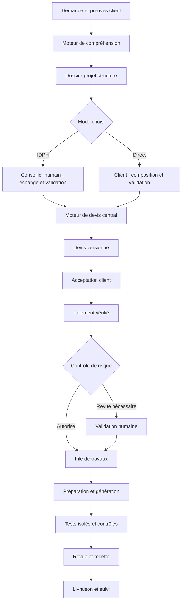

# MerKora — modes de service, Fabrique et registre des intégrations

**Statut :** architecture cible et registre de vérification. Ce document ne signifie pas que les services externes sont déjà connectés ou installés.

## 1. Deux parcours commerciaux, un seul dossier projet

### MerKora IDPH — accompagnement humain

1. Le client expose librement son besoin, ses difficultés, ses objectifs, ses moyens et ses contraintes.
2. L'assistant organise les informations et prépare un dossier structuré sans remplacer les paroles originales.
3. Un conseiller humain échange directement avec le client dans l'espace de discussion.
4. Le conseiller corrige et confirme les éléments du dossier, prépare le périmètre et construit le devis à partir du catalogue de prix administré.
5. Le devis est transmis au client dans la conversation. Le client l'accepte ou demande une modification.
6. Le paiement est vérifié avant le lancement des travaux.
7. Le conseiller alimente la fiche de suivi et la Fabrique avec les décisions, les pièces, les priorités et les critères de livraison.
8. La Fabrique prépare, construit, teste et remet le produit ; le conseiller suit la relation jusqu'à la livraison.

### MerKora Direct — autonomie encadrée

1. Le client suit le parcours de compréhension et de définition.
2. À l'écran 06, il nomme son projet, choisit le type de produit et un ou plusieurs domaines, puis compose les modules proposés.
3. MerKora calcule le devis à partir des règles et tarifs que l'administrateur a configurés.
4. Le client visualise la proposition, la maquette et le devis, puis valide.
5. Le paiement doit être confirmé par une preuve serveur vérifiable (notification du prestataire/webhook ou rapprochement contrôlé), jamais par un simple clic ou une capture d'écran déclarative.
6. Après confirmation, le système peut mettre le travail en file d'attente de la Fabrique.
7. Les cas risqués, ambigus, coûteux, réglementés ou techniquement impossibles passent en revue humaine avant exécution.

**Règle commune :** IDPH et Direct utilisent le même dossier projet, les mêmes catalogues métier, le même moteur de compréhension, le même moteur de devis et la même Fabrique. Seuls les niveaux d'assistance, de validation et d'automatisation changent.

## 2. Cycle de vie de la Fabrique

La Fabrique doit fonctionner par tâches traçables et reprises possibles : chaque génération possède un identifiant, une version de dossier, les entrées utilisées, les outils appelés, le résultat, les tests et l'approbation requise. Aucun outil externe ne doit pouvoir déclencher une dépense ou une publication sans règle d'autorisation explicite.

## 3. Pôles internes à construire

| Pôle | Responsabilité |
|---|---|
| Compréhension | Lexique, analyse des formulations, extraction d'éléments, détection des contradictions, clarification et conservation des sources. |
| Référentiel universel | Familles métier, domaines, métiers, processus, problèmes, causes, indicateurs, équipements, règles et relations. |
| Catalogue produit | Types de réalisation distincts : site vitrine, plateforme, application mobile, logiciel web, réservation, e-commerce, jeu, générateur, conception architecturale et solution opérationnelle. |
| Composition hybride | Fusion de plusieurs domaines sans fusionner leurs règles métier ; dépendances et incompatibilités explicites. |
| Expérience et rôles | Navigation, identité visuelle, espaces, droits, espace propriétaire administrateur et espaces des utilisateurs finaux. |
| Devis | Catalogue tarifaire administré, lignes de prix, options, coûts récurrents, maintenance, taxes éventuelles, version du tarif et instantané du devis. |
| Paiement | Création de commande, état du paiement, confirmation côté serveur, rapprochement, remboursement et journal d'audit. |
| Fabrique | Génération de code, documents, médias, maquettes ou procédures ; tests isolés, revue et livraison. |
| Connexions | Registre des connecteurs, secrets, permissions, coûts, licences, disponibilité, limites et journaux. |
| Administration | Demandes, échanges IDPH, devis, paiements, suivi de réalisation, catalogue de prix, connecteurs et incidents. |

## 4. Règles commerciales et de sécurité

- Les tarifs officiels sont définis et publiés par l'administration MerKora. L'IA peut estimer la charge et suggérer des lignes, mais ne modifie pas les tarifs officiels.
- Le devis Direct peut être calculé automatiquement seulement à partir d'un catalogue tarifaire actif et versionné.
- Le devis IDPH reste soumis à la revue du conseiller avant envoi.
- Le devis conserve une copie des tarifs et règles qui ont servi à son calcul ; une modification ultérieure du catalogue ne réécrit pas un devis déjà accepté.
- Le paiement est une condition préalable au démarrage des travaux payants. Une notification navigateur ou une preuve envoyée par le client n'est pas une preuve de paiement.
- Le lancement d'un rendu GPU, d'une génération payante, d'une publication ou d'une commande externe doit être soumis à un contrôle de budget et à une permission.
- Les secrets restent côté serveur dans des variables d'environnement ou un coffre dédié ; ils ne sont jamais envoyés au navigateur, ajoutés à Git ou placés dans les prompts.
- Les données sensibles ne sont envoyées à un fournisseur externe que si la fonction le nécessite, si le fournisseur et sa politique ont été évalués et si le client ou l'administrateur l'a autorisé.
- Les connecteurs sont facultatifs et remplaçables : une indisponibilité externe ne doit pas détruire le dossier projet.

## 5. Registre des outils cités dans l'audio

Les statuts ci-dessous distinguent l'identification du produit, son aptitude technique et son autorisation d'intégration. « À évaluer » ne signifie pas « connecté ».

| Outil cité | Identification / usage possible | Statut et décision |
|---|---|---|
| Gemini | Moteur de compréhension déjà utilisé selon le propriétaire du projet ; clé déclarée dans les variables Vercel. | **Déjà configuré selon l'historique utilisateur**, mais présence, nom exact de variable, permissions, modèle, quota et appel réel doivent être vérifiés sans afficher la clé. |
| GitHub | Dépôts, code source, issues, branches, PR, Actions, artefacts, sécurité et découverte open source. | **Connecté à ChatGPT** pour le dépôt MerKora-GDJ. À exploiter comme forge et chaîne de livraison, pas comme coffre à secrets ni comme catalogue de logiciels automatiquement sûrs. |
| MerKora Apps Script | Application interne évoquée avec identifiant et procédure d'installation. | **Dépôt exact non retrouvé** dans les dépôts accessibles sous le compte GitHub actuellement consulté. Ne pas inventer son nom ni son ID ; le retrouver avant d'établir le pont. |
| OpenField (prononcé « Open X Field ») | Studio open source de génération vidéo, images et 3D, piloté par ComfyUI ; expose aussi des outils MCP. | **Candidat réel, mais lourd** : rendu local GPU, 24 Go de VRAM recommandés pour la vidéo, dizaines de Go de modèles et dépendances. À réserver à un worker GPU dédié ou à une machine du studio, pas à une fonction serverless Vercel standard. Code MIT ; les poids ont leurs propres licences. |
| video-agent-skills de Melvynx | Compétences d'agent pour scénariser, rechercher, monter et préparer des vidéos courtes/longues ; moteur Node, Chrome et FFmpeg. | **Candidat prioritaire pour le studio média**, à installer dans un environnement de travail contrôlé. La publication sociale et les appels payants doivent rester soumis à confirmation. Licence MIT pour le dépôt ; dépendances et services optionnels à vérifier séparément. |
| Chatterbox (prononcé « Open Chatter Boss ») | Modèle open source de synthèse vocale et clonage de voix. | **Non retenu en production** : le dépôt resemble-ai/chatterbox annonce sa retraite et l'arrêt de maintenance en août 2026. Évaluer une alternative maintenue ; ne cloner une voix qu'avec consentement explicite et preuve de droits. |
| OpenSEO | Audit SEO auto-hébergé et analyse de sites. | **Candidat à évaluer** pour l'audit des sites livrés ; vérifier licence, sécurité du crawler, limites et charge avant déploiement. |
| AppFlowy | Espace de travail collaboratif open source (documents, wiki, projets), alternative à Notion. | **Candidat pour documentation/back-office**, éventuellement auto-hébergé. Licence AGPL-3.0 : revue juridique obligatoire avant intégration dans un produit distribué ou modification du code. Ne pas le confondre avec la base métier MerKora. |
| Handy | Application desktop de transcription vocale entièrement hors ligne. | **Utile pour le poste de travail IDPH**, pas un service web Vercel prêt à appeler. Les données vocales restent locales selon le projet. |
| Plane (probablement le « Plain » de l'audio) | Gestion de projets, tâches, cycles et documentation. | **Identification probable, à confirmer**. Candidat pour le suivi interne de réalisation ; licence AGPL-3.0, donc hébergement et usage à examiner. |
| OpenCalc | Nom de plusieurs projets différents (calculatrice scientifique open source, réimplémentation de calculatrice Windows, etc.). | **Non identifié** : demander le lien exact avant toute intégration. |
| OpenCap | Projet Stanford/University of Utah de capture du mouvement humain en 3D à partir de vidéos de smartphones, avec estimation cinématique et biomécanique. | **Identifié, mais usage restreint** : dépôt opencap-org/opencap-core, licence Apache 2.0 ; service gratuit destiné à la recherche et à l'enseignement non commerciaux. À réserver à des cas d'analyse du mouvement avec consentement et revue juridique ; pas à un service commercial MerKora sans autorisation/licence appropriée. |
| Shuttlework / Shuttle | « Shuttlework » n'a pas été identifié. Un projet distinct, Shuttle (shuttle-hq/shuttle), est un outil de déploiement Rust. | **Ambigu** : le dépôt Shuttle a été archivé le 25 avril 2026 ; ne pas le confondre avec le nom prononcé. Demander le lien exact avant toute décision. |
| OpenBB (prononcé « Bloomberg » dans l'audio) | Plateforme open source de données financières et analytiques, avec intégrations de données, API et outils pour agents. | **Candidat spécialisé finance/étude de marché**. Les sources de données peuvent être payantes, sous licence ou soumises à quotas ; l'outil ne rend pas toutes les données gratuites. |
| Jobble.cc | Service cité pour étude de marché, offre, site, marketing et stratégie. | **À vérifier** : la recherche publique a surtout retrouvé Jobble.com, qui décrit une plateforme d'acquisition de clients et de gestion de main-d'œuvre, ce qui ne confirme pas la fonction décrite ni le domaine jobble.cc. Ne pas connecter un domaine différent par supposition. |
| ERNIE / Baidu | Famille de modèles ERNIE et assistant Baidu ; ERNIE 4.5 possède des poids publiés et des outils développeurs. | **Candidat IA alternatif**. Distinguer l'application de chat gratuite d'une API utilisable en production ; vérifier région, conditions, prix, confidentialité et disponibilité depuis le Bénin. |
| Ling / Ant | Famille de modèles Ant Ling ; endpoint développeur et modèles flash/multimodaux. | **Candidat IA alternatif**, à comparer avec Gemini sur français, coût réel, latence, politique de données et stabilité de l'API. |
| Qwen Studio / Alibaba | Interface de chat et famille de modèles Qwen pour écriture, recherche, code, fichiers et images. | **Candidat IA et multimodal**. Qwen Studio, l'API Alibaba Cloud et les poids ouverts sont trois offres distinctes ; ne pas supposer que le chat gratuit donne une API gratuite. |
| Dreamina / ByteDance | Outil créatif de génération et d'édition d'images et vidéos. | **Candidat média**. Vérifier l'accès API, les droits commerciaux, les quotas, les filigranes, la région et le coût ; l'existence d'une application ne garantit pas un connecteur API. |
| Cloud (non précisé) | Hébergement ou stockage cloud évoqué pour relier MerKora à d'autres services. | **À préciser** : fournisseur, comptes, région, type de service, budget et données autorisées. Vercel est déjà utilisé pour l'application ; ne pas créer un nouveau service payant par défaut. |

## 6. Architecture des connexions internes et externes

Chaque connecteur doit être décrit dans un registre machine-readable et dans l'administration avec :

- identifiant, nom, éditeur, dépôt ou endpoint officiel ;
- capacités offertes et tâches MerKora autorisées ;
- mode de connexion : API REST, webhook, MCP, CLI, SDK, fichier ou poste local ;
- environnement d'exécution : navigateur, serveur, worker, machine locale ou cloud GPU ;
- permissions minimales, propriétaire du secret, date de rotation et état de santé ;
- données entrantes/sortantes, région et règles de confidentialité ;
- licence du code, licence des modèles/données et conditions commerciales ;
- prix par appel, par minute, par jeton, par rendu ou par volume ;
- quotas, limites, délais, politique de reprise et solution de secours ;
- validation humaine requise, journal d'audit et bouton de désactivation.

**Principe d'intégration :** l'application MerKora appelle ses propres interfaces internes ; celles-ci sélectionnent le connecteur approprié. Le navigateur ne contacte jamais directement un fournisseur avec une clé secrète. Les connecteurs coûteux ou lourds sont exécutés dans des workers adaptés et non dans le cycle de requête d'une page web.

## 7. Priorité d'intégration recommandée

1. Stabiliser les interfaces internes et le registre des connecteurs ; vérifier le dépôt Apps Script et l'environnement Gemini sans exposer de secret.
2. Construire le moteur de devis, la validation du paiement et la file de travaux avant d'autoriser la Fabrique à lancer des tâches payantes.
3. Exploiter GitHub Actions, les branches, PR, tests, artefacts et scans de sécurité pour générer et vérifier les projets.
4. Ajouter un environnement média contrôlé pour video-agent-skills ; tester Handy localement pour l'IDPH.
5. Évaluer AppFlowy ou Plane pour le suivi interne, sans les imposer aux clients.
6. Tester OpenSEO et OpenBB dans leurs domaines respectifs.
7. Comparer Gemini, ERNIE, Ling et Qwen sur un jeu d'évaluation MerKora avant tout routage multi-modèle.
8. Étudier OpenField seulement après estimation du coût d'un worker GPU et vérification des licences des modèles.
9. Garder OpenCalc, OpenCap, Shuttlework et Jobble.cc en attente de liens exacts.

## 8. Cas de test métier pour valider l'universalité

- Aéro Service : présence + réservation + gestion d'équipe + règles de retard.
- WALL Trade : commerce + stock + commande + réseau de revendeurs + commissions.
- Ginesse de Paris Center Work : services, tarifs unitaires, caisse, moyens de paiement et suivi.
- Student Vision : éducation/orientation, questionnaires, tests, résultats et explication des recommandations.
- Projet de conception architecturale : relevés, plans, visualisation 3D, matériaux et validation.

Chaque cas doit vérifier que les domaines combinés restent distincts, que les suggestions ne deviennent pas des faits, que le devis reprend les tarifs configurés et que la Fabrique ne démarre pas avant les autorisations et le paiement exigés.
