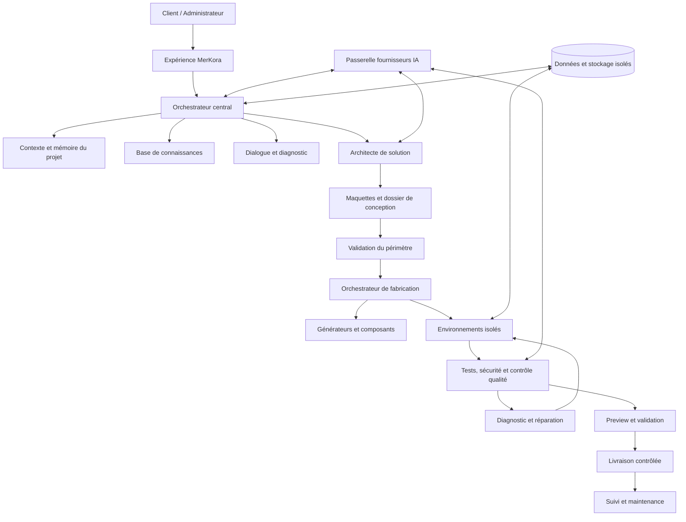

# MerKora GDJ — Conception de la plateforme universelle adaptative

- **Date :** 2026-11-12
- **Statut :** conception proposée, à relire avant planification d'implémentation
- **Dépôt :** `merkelnascom-art/Merkora-GDJ`
- **Branche documentaire :** `feature/merkora-rebuild-foundation`
- **Périmètre :** architecture cible de MerKora GDJ et découpage des sous-projets
- **Règle de livraison :** aucun merge dans `main`, aucune promotion en production et aucune opération destructive sur Supabase sans autorisation explicite.

## 1. Résumé exécutif

MerKora GDJ est une plateforme qui comprend le besoin réel d'une personne ou d'une organisation, conçoit avec elle une solution numérique adaptée, puis orchestre sa fabrication, sa vérification, sa livraison et son suivi.

MerKora, et non un opérateur humain ou un assistant externe, doit exécuter le parcours métier : analyser, questionner, recommander, concevoir, fabriquer, tester, diagnostiquer et préparer la livraison. Les humains conservent la validation des décisions engageantes : périmètre final, devis, paiements, accès sensibles, publication et déploiement en production.

La plateforme doit s'adapter à tout type de projet. Les référentiels sectoriels, prompts, exemples, codes et modèles déjà fournis par le propriétaire sont des ressources de connaissance à inventorier, structurer et exploiter. Les secteurs constituent une bibliothèque évolutive, pas une liste fermée ni une limite fonctionnelle. Un projet peut appartenir à plusieurs secteurs ou à un domaine inédit.

Le premier projet pilote commercial est Asho Sweet. Il sert à vérifier le parcours réel de bout en bout, mais ne doit pas imposer une architecture « boutique/pâtisserie » au moteur universel.

## 2. Contexte et état initial observé

La branche documentaire contient déjà un socle Next.js App Router, React, TypeScript et Vitest, un espace de travail de découverte de besoins, des propositions locales et une intégration IA activable explicitement via Vercel AI Gateway. Le README décrit l'IA désactivée par défaut, l'authentification Supabase, la synchronisation des dossiers et un studio de maquettes conceptuelles.

L'état observé est encore un prototype : certaines données restent locales au navigateur, les maquettes ne sont pas des applications fonctionnelles, les devis officiels, les paiements et le suivi de réalisation restent à développer. Le générateur actuel connu dans une branche de travail antérieure comporte un scaffold générique limité et un traitement spécifique Asho Sweet ; il ne constitue pas encore un moteur universel de fabrication. Cette différence doit être prise en compte lors de la planification.

**Conséquence :** ne pas confondre les fonctions visibles du prototype, les composants expérimentaux et les capacités réellement opérationnelles. Toute capacité devra être vérifiée par des tests et des preuves d'exécution avant d'être annoncée comme disponible.

## 3. Objectifs

1. Permettre à toute personne de décrire un besoin sans connaissance technique préalable.
2. Poser des questions adaptatives, sous forme de choix multiples, réponses libres ou combinaison des deux.
3. Exploiter les ressources métier, prompts, exemples, modèles et composants fournis.
4. Concevoir une solution traçable : utilisateurs, rôles, permissions, modules, données, workflows, interfaces, intégrations, contraintes et risques.
5. Présenter des maquettes compréhensibles et modifiables avant la fabrication.
6. Générer des applications fonctionnelles à partir d'un dossier de conception approuvé.
7. Tester, diagnostiquer et corriger les erreurs dans un environnement isolé.
8. Préparer une Preview vérifiable, puis une livraison contrôlée.
9. Suivre les applications après livraison selon les engagements contractuels.
10. Réutiliser les composants communs sans mélanger les données ni les règles des clients.

## 4. Non-objectifs et limites de cette conception

- Remplacer immédiatement tous les composants existants sans audit ni migration.
- Déployer automatiquement en production sans validation.
- Activer des fournisseurs IA ou lancer des opérations payantes sans budget et configuration vérifiés.
- Importer aveuglément des centaines de secteurs, prompts ou scripts sans contrôle de qualité, déduplication, provenance et classification.
- Exécuter directement des SQL d'exemple ou des scripts fournis sans revue de sécurité.
- Faire croire qu'une maquette est une application terminée.
- Garantir qu'un modèle IA ne commettra jamais d'erreur.
- Construire tous les domaines métiers en une seule livraison monolithique.

## 5. Principes directeurs

### 5.1 Universalité adaptative

Le moteur central est générique. Les connaissances sectorielles, règles métier et modules sont des ressources sélectionnées selon le contexte. Les domaines inconnus déclenchent une analyse prudente et des questions ciblées, pas un refus automatique.

### 5.2 Client maître de ses décisions

Le client peut accepter, modifier, refuser ou différer une proposition. Une suggestion IA ne devient jamais une décision approuvée par défaut. Le système conserve la réponse originale, la proposition IA, la décision humaine et l'historique des versions.

### 5.3 Human-in-the-loop pour les actes engageants

Les devis, paiements, engagements externes, autorisations sensibles, accès aux données sensibles et déploiements de production exigent une validation autorisée. Les tâches routinières réversibles peuvent être automatisées dans les limites définies.

### 5.4 Sécurité et isolation par défaut

Chaque projet et chaque client ont un périmètre d'accès explicite. Les données, fichiers, secrets, journaux et environnements de fabrication ne doivent pas être accessibles à un autre tenant. Les contrôles d'autorisation sont effectués côté serveur et dans la base, pas uniquement dans l'interface.

### 5.5 Préserver l'existant

Aucune réinitialisation ou suppression des données Supabase existantes. Les migrations futures doivent être additives par défaut, documentées, testées, réversibles lorsque possible et accompagnées d'une stratégie de sauvegarde. Aucun changement à WALL Trade ou aux autres projets.

### 5.6 Transparence des coûts

Les appels IA, environnements de build, stockage, notifications, services externes et hébergement ont des budgets, quotas et journaux d'usage. Le mode local ou économique doit rester disponible quand il est pertinent.

## 6. Architecture logique cible

### 6.1 Composants et responsabilités

| Composant | Responsabilité | Ne doit pas faire |
|---|---|---|
| Interface client | Recueillir besoins, choix, textes, fichiers et validations | Décider à la place du client |
| Console administrateur | Piloter dossiers, devis, validations, coûts, fabrication et suivi | Exposer les secrets ou données d'autres clients |
| Orchestrateur | Distribuer les tâches, gérer états, reprises, budgets et traces | Exécuter aveuglément les sorties IA |
| Mémoire de projet | Conserver contexte, réponses, décisions, versions et artefacts | Mélanger deux projets |
| Base de connaissances | Indexer secteurs, prompts, règles, modèles et composants | Traiter toute ressource importée comme fiable |
| Analyste | Comprendre, questionner, détecter omissions et contradictions | Inventer des faits ou imposer un choix |
| Architecte | Définir modules, données, rôles, workflows et contraintes | Démarrer la fabrication avant approbation |
| Studio de conception | Présenter maquettes, parcours et dossier | Présenter un prototype visuel comme fonctionnel |
| Factory | Générer le code, configurer et assembler les modules | Déployer en production de sa propre initiative |
| Environnement d'exécution | Installer, compiler et tester en isolation | Accéder aux secrets ou données d'un autre projet |
| Contrôleur qualité | Vérifier exigences, tests, sécurité et régressions | Déclarer réussi un test non exécuté |
| Supervision | Suivre disponibilité, erreurs, coûts et maintenance | Modifier les données métier sans autorisation |

## 7. Base de connaissances et ressources déjà fournies

La base de connaissances doit pouvoir accueillir les ressources existantes du propriétaire : référentiels sectoriels (dont le catalogue annoncé de 500 secteurs), prompts, prompts de génération, exemples, scripts, schémas, modèles d'applications, règles métier, composants et documentation.

### 7.1 Ingestion et gouvernance

Chaque ressource importée reçoit au minimum :
- un identifiant stable ;
- un titre, une description et une langue ;
- une catégorie (secteur, rôle, workflow, prompt, code, schéma, composant, règle, exemple) ;
- des secteurs et mots-clés associés, sans exclusivité ;
- une provenance et une date d'import ;
- une version et un statut de validation ;
- des dépendances et prérequis ;
- une classification de sécurité et de sensibilité ;
- des tests ou exemples d'utilisation si applicables.

Pipeline d'ingestion : inventaire → extraction → normalisation → déduplication → classification → revue sécurité/licence → indexation → test de récupération → publication dans le catalogue. Les ressources ne sont pas réécrites ni supprimées pendant l'import initial.

### 7.2 Recherche et sélection

La récupération combine filtres structurés (secteur, type de ressource, version, compatibilité) et recherche sémantique. Le moteur doit présenter les ressources mobilisées et leur provenance dans le dossier de conception. Les ressources contradictoires ou non vérifiées sont signalées.

### 7.3 Évolution

Le catalogue est extensible. Un nouveau secteur peut être ajouté sans modifier le cœur. Les projets multi-sectoriels peuvent composer plusieurs ensembles de connaissances. Un domaine absent est traité à partir de principes génériques, avec incertitudes explicites et validation humaine.

## 8. Dialogue et diagnostic adaptatifs

### 8.1 Entrées acceptées

- Texte libre et conversation naturelle.
- Questions à choix unique ou multiples.
- Champs structurés et cases à cocher.
- Espace complémentaire libre en bas de chaque groupe de questions.
- Documents, images, exemples et pièces jointes, selon les types autorisés.
- Réponse « Je ne sais pas, conseillez-moi ».
- Questions de suivi contextuelles.

Le client peut cocher, écrire, faire les deux ou laisser une réponse vide lorsque celle-ci n'est pas indispensable.

### 8.2 Cycle de questionnement

1. Comprendre le récit initial.
2. Identifier le résultat attendu et les inconnues.
3. Sélectionner les questions les plus utiles.
4. Proposer des réponses possibles sans enfermer le client dans la liste.
5. Collecter les précisions libres.
6. Détecter les contradictions, dépendances et risques.
7. Expliquer les conséquences et demander les validations nécessaires.
8. Produire un diagnostic structuré avec niveau de confiance et points ouverts.

### 8.3 Données à examiner

Activité, objectifs, modèle économique, utilisateurs, propriétaire, rôles, droits, parcours, processus, données, paiements, communication, intégrations, appareils, disponibilité hors ligne, sécurité, confidentialité, contraintes légales, budget, calendrier, hébergement, maintenance et évolution.

### 8.4 Traçabilité

Pour chaque élément : origine (client, document, IA, administrateur), valeur originale, interprétation, statut (à clarifier, proposé, accepté, refusé), date et version. Les suggestions IA ne sont jamais confondues avec les exigences confirmées.

## 9. Architecture de solution et conception visuelle

L'architecte produit un dossier comprenant :
- objectifs et périmètre ;
- personas et parcours ;
- utilisateurs, rôles et permissions granulaires ;
- modules essentiels, optionnels et exclus ;
- workflows et règles métier ;
- modèle de données et politique de conservation ;
- écrans, navigation et états d'interface ;
- intégrations, API et événements ;
- exigences de sécurité, performance, accessibilité et disponibilité ;
- estimation indicative, hypothèses, risques et dépendances ;
- critères d'acceptation et plan de tests.

La profondeur est adaptative : un site vitrine simple peut suivre un parcours court ; un ERP, une plateforme multi-tenant ou une application financière/médicale exige une conception approfondie, des contrôles renforcés et des validations explicites.

Le studio de maquettes produit des prototypes identifiés comme tels, liés à une version du dossier. Le client peut annoter, demander des modifications et approuver une version précise. La maquette approuvée devient une référence de fabrication.

## 10. Moteur de fabrication universel

### 10.1 Contrat d'entrée

Le Factory reçoit uniquement un dossier approuvé et versionné : exigences, architecture, modules, maquettes, règles, modèle de données, intégrations, contraintes, critères d'acceptation et budget autorisé.

### 10.2 Planification

Le planificateur découpe le travail en tâches dépendantes, attribue les outils et modèles nécessaires, estime les ressources, fixe des limites et conserve les résultats. Les tâches doivent être idempotentes lorsque possible et reprendre proprement après échec.

### 10.3 Génération

Le moteur assemble des composants vérifiés, puis crée les composants spécifiques. Les modules doivent être indépendants, documentés et testables. Les templates sectoriels sont des accélérateurs, jamais des branches rigides qui limitent les projets.

### 10.4 Environnements

Chaque job de fabrication utilise un environnement éphémère ou isolé, avec limites de CPU, mémoire, durée, réseau, stockage et coût. Les secrets sont injectés au strict nécessaire, jamais inclus dans les prompts client, les logs, les artefacts publics ou le navigateur. Les accès réseau sortants sont contrôlés.

### 10.5 Sorties

Code source, manifeste des dépendances, migrations proposées, documentation, rapport de build, résultats de tests, inventaire des secrets/configurations nécessaires (sans valeurs), artefacts de Preview et rapport des limites connues.

## 11. Qualité, tests et réparation

La qualité vérifie :
- cohérence avec les exigences approuvées ;
- typecheck, lint et build ;
- tests unitaires, intégration et parcours ;
- authentification, rôles, permissions et isolation tenant ;
- validation et intégrité des données ;
- sécurité des API, fichiers et secrets ;
- accessibilité et responsive ;
- performance et erreurs runtime ;
- absence de régression sur les fonctions existantes.

Boucle de réparation : détecter → reproduire → isoler la cause → proposer un correctif → exécuter les tests ciblés → exécuter les tests de régression → conserver le diff et les logs. Nombre de tentatives, temps et coût sont plafonnés. En cas d'échec répété, le job s'arrête et demande une intervention.

Une fonctionnalité n'est « validée » que si les tests correspondants ont réellement été exécutés et si leurs résultats sont disponibles.

## 12. Fournisseurs IA et orchestration

Une couche d'abstraction indépendante des fournisseurs permet d'utiliser OpenAI, Gemini et d'autres fournisseurs compatibles, selon la tâche, les capacités, la qualité attendue, la disponibilité et le coût.

Fonctions attendues :
- routage par type de tâche ;
- configuration par environnement et par modèle ;
- fallback contrôlé ;
- timeouts, retry borné et gestion des erreurs ;
- budgets et quotas par projet/tenant ;
- journalisation des modèles, tokens/usage, latence, coût estimé et résultat ;
- évaluation de qualité et détection des sorties invalides ;
- protection des données envoyées aux fournisseurs ;
- secrets conservés exclusivement côté serveur.

Les noms de variables d'environnement précédemment communiqués ne prouvent pas que les clés sont présentes ni fonctionnelles dans chaque environnement. L'état Production/Preview et la capacité réelle de chaque fournisseur devront être vérifiés séparément, sans afficher ni demander les valeurs secrètes. Vercel AI Gateway existant doit être audité avant d'ajouter un second chemin d'appel. Éviter les doublons et appels payants inutiles.

## 13. Données, identité et sécurité multi-tenant

### 13.1 Modèle logique

Entités conceptuelles :
- tenants/organisations ;
- membres et identités ;
- rôles, permissions et affectations ;
- projets et membres de projet ;
- besoins, réponses et pièces jointes ;
- décisions et validations ;
- ressources de connaissances et versions ;
- dossiers de conception et versions de maquettes ;
- modules et configurations ;
- jobs, tâches, logs et artefacts ;
- rapports de tests et incidents ;
- devis, factures, paiements et événements de facturation ;
- notifications, consentements et préférences ;
- événements d'audit.

Ce modèle est conceptuel. Il ne constitue pas une migration SQL à exécuter telle quelle.

### 13.2 Contrôles

- Autorisation serveur et RLS sur chaque donnée tenant.
- Vérification de l'appartenance et du rôle pour chaque opération.
- Accès public limité explicitement aux données publiées et non sensibles.
- Permissions granulaires et refus par défaut.
- Secrets chiffrés et séparés des données applicatives.
- Liens de fichiers signés, durée courte et contrôle d'accès.
- Journal d'audit pour les opérations sensibles.
- Protection contre IDOR, élévation de privilèges, injection, SSRF et exécution de code non fiable.
- Chiffrement en transit et au repos selon les capacités des services.
- Règles spécifiques et revue renforcée pour les données financières, médicales ou autres données sensibles.
- Sauvegarde et restauration testées avant toute migration risquée.

### 13.3 Préservation de Supabase

Le projet Supabase MerKora existant est conservé. Aucun reset, drop global, suppression de données ou changement non examiné. Les schémas et politiques actuels doivent être audités en lecture seule avant de proposer des migrations additives. Les migrations de chaque sous-projet sont séparées, testées sur un environnement non productif et révisées avant application.

## 14. Cycle de vie d'un projet client

États recommandés :
1. brouillon ;
2. découverte en cours ;
3. informations à clarifier ;
4. diagnostic prêt ;
5. conception en cours ;
6. conception à valider ;
7. conception approuvée ;
8. devis à préparer ;
9. devis soumis ;
10. devis accepté ;
11. fabrication planifiée ;
12. fabrication en cours ;
13. contrôle qualité ;
14. Preview à valider ;
15. prêt pour livraison ;
16. livraison autorisée ;
17. livré ;
18. maintenance/suivi ;
19. suspendu ou clôturé selon contrat.

Chaque transition est autorisée selon le rôle, les conditions métier et les validations attendues. Les événements sont horodatés et auditables. Les statuts ne doivent pas être modifiables arbitrairement par le navigateur.

## 15. Notifications et suivi client

Pour Asho Sweet, conserver les deux parcours validés :
- suivi invité par référence de commande et téléphone ;
- compte client facultatif permettant de consulter plusieurs commandes ;
- rattachement ultérieur d'une commande invitée à un compte après vérification sécurisée.

Les changements de statut peuvent produire des notifications dans l'application, puis e-mail, WhatsApp ou SMS si le canal est intégré, autorisé, consenti et budgété. La livraison d'une notification doit être traçable. Les notifications ne doivent pas révéler de données sensibles à un destinataire non vérifié.

Ce mécanisme doit être généralisable à d'autres domaines : rendez-vous, dossiers, livraisons, demandes, interventions ou inscriptions.

## 16. Administration et gouvernance

La console MerKora permet aux administrateurs autorisés de :
- consulter et trier les demandes ;
- suivre l'analyse et la conception ;
- examiner les modules et maquettes ;
- contrôler devis et paiements ;
- valider ou bloquer les étapes engageantes ;
- surveiller les jobs, logs, coûts et erreurs ;
- examiner les rapports de tests ;
- autoriser une Preview ou un déploiement ;
- gérer les intégrations et leurs états ;
- consulter l'audit et le suivi après livraison.

Le plan interne de fabrication, les prompts système, les secrets et les logs sensibles ne sont pas exposés aux clients. Le client voit les livrables, décisions et informations qui le concernent.

## 17. Observabilité, fiabilité et coûts

Indicateurs : taux de succès des analyses, questions sans réponse, durée par phase, réussite build/test, taux de réparation, temps de reprise, coût IA par tâche/projet, coût de fabrication, erreurs runtime, disponibilité et échecs de notification.

Chaque job possède un identifiant de corrélation. Les logs sont structurés, expurgés des secrets et limités en durée selon une politique de conservation. Les budgets et quotas peuvent bloquer un job avant dépassement. Les erreurs fournisseur, build et intégration sont distinguées.

## 18. Stratégie de validation et tests

### Tests fonctionnels
- Questionnaire avec choix multiples, texte libre et réponses combinées.
- Possibilité de répondre « Je ne sais pas » et de demander conseil.
- Questions dynamiques et détection des contradictions.
- Distinction entre demande client, suggestion IA et décision approuvée.
- Composition de plusieurs secteurs et traitement d'un secteur absent.
- Rôles et permissions propres à chaque projet.
- Maquettes versionnées et validation d'une version précise.
- Génération à partir d'un dossier approuvé.
- Boucle de tests et de réparation avec arrêt sur échec répété.
- Suivi invité et compte client, rattachement sécurisé et notifications de statut.

### Tests sécurité
- Accès croisé entre tenants et projets.
- Tentatives d'accès à des ressources par identifiant deviné.
- Permissions serveur et RLS.
- Secrets absents des bundles, logs et artefacts.
- Uploads et téléchargements de fichiers.
- Injection de prompt et code non fiable dans les ressources importées.
- Protection des endpoints de job et des callbacks worker.

### Critères de sortie
Aucune phase n'est déclarée terminée sur la seule base d'une réponse IA. Chaque fonction doit avoir des tests automatisés et, lorsque pertinent, une vérification manuelle en Preview. Les résultats sont attachés au job ou au rapport de validation.

## 19. Déploiement, migration et retour arrière

- Développer sur une branche de travail dédiée, sans écraser les travaux existants.
- Utiliser Preview pour les vérifications.
- Séparer les variables et autorisations Preview/Production.
- Ne pas déclencher de Sandbox ou service payant sans budget/autorisation.
- Préparer les migrations Supabase en mode additif, avec sauvegarde, revue et plan de retour arrière.
- Ne pas fusionner dans `main` et ne pas déployer en production sans approbation explicite.
- Documenter les changements et preuves de test à chaque livraison.

## 20. Découpage en sous-projets indépendants

L'ensemble est trop vaste pour un seul cycle de développement. Le travail doit être livré par sous-projets avec contrats d'interface stables.

| Ordre | Sous-projet | Résultat vérifiable |
|---|---|---|
| 1 | Inventaire et base de connaissances | Ressources existantes cataloguées, versionnées et retrouvables |
| 2 | Cerveau central et orchestration IA | Routage, contexte, budgets, journaux et fallback |
| 3 | Dialogue et diagnostic universels | Parcours adaptatif, cases à cocher et texte libre |
| 4 | Architecte et studio de conception | Dossiers structurés, rôles, modules et maquettes versionnées |
| 5 | Factory universelle | Génération non limitée à Asho Sweet |
| 6 | Environnements et contrôleur qualité | Builds isolés, tests, réparations plafonnées |
| 7 | Cycle commercial et administration | Validation, devis, autorisations et suivi |
| 8 | Livraison et supervision | Preview, déploiement autorisé, incidents et maintenance |
| 9 | Pilote Asho Sweet | Parcours de commande et suivi client validés en conditions contrôlées |

Le sous-projet 1 est le premier à planifier. Il doit retrouver les ressources déjà transmises dans le dépôt, les pièces disponibles et les fichiers accessibles, sans demander au propriétaire de tout renvoyer. Si une ressource n'est pas accessible, l'indiquer précisément et conserver son emplacement attendu au lieu d'inventer son contenu.

## 21. Risques et mesures

| Risque | Mesure |
|---|---|
| Catalogue de ressources incomplet ou dupliqué | Inventaire, provenance, versions et validation |
| Sortie IA incorrecte | Validation, critères d'acceptation et tests |
| Projets trop spécifiques | Cœur générique, modules configurables et plugins |
| Fuite entre clients | Isolation tenant, RLS et tests d'accès croisés |
| Dépenses IA/build imprévues | Budgets, quotas, arrêt automatique et mode local |
| Réparation qui dégrade l'application | Diff isolé, tests de régression et plafond d'essais |
| Confusion prototype/production | Statuts et rapports de vérification explicites |
| Migration destructive | Audit préalable, migration additive et sauvegarde |
| Déploiement prématuré | Approbation humaine explicite |

## 22. Décisions acquises et points à vérifier

### Décisions acquises
- MerKora doit servir des projets de tous secteurs et des projets multi-sectoriels.
- Les ressources existantes du propriétaire sont destinées à être exploitées par MerKora.
- Le dialogue accepte cases à cocher, réponses libres et combinaison des deux.
- Le client peut demander conseil et laisser une réponse inconnue.
- Le parcours de conception est adaptatif selon la complexité.
- Le client garde la maîtrise des décisions importantes.
- Le moteur de fabrication doit être universel, isolé, testable et capable de réparer avec limites.
- Asho Sweet est le premier pilote, pas le modèle unique de la plateforme.
- Le suivi Asho Sweet accepte le mode invité et le compte client facultatif.
- Les notifications de changement de statut sont prévues selon consentement, intégration et coût.
- Aucune donnée Supabase existante ne doit être réinitialisée ou supprimée.
- Pas de merge ou de production sans autorisation explicite.

### Vérifications techniques requises avant implémentation
- Inventaire exact des ressources disponibles et des 500 secteurs annoncés.
- État réel des branches, du worker, de l'authentification GitHub App et des environnements Preview.
- État réel des variables OpenAI/Gemini dans chaque environnement, sans lire ni exposer leurs valeurs.
- État et politiques RLS des tables Supabase existantes.
- Capacités et coût réels des environnements de fabrication et du stockage.
- Statut réel du générateur et de l'artefact Asho Sweet.

Ces vérifications sont des tâches de découverte et de preuve ; aucune valeur de secret ne doit être demandée dans la conversation.

## 23. Critères d'acceptation de l'architecture

L'architecture est prête à passer en planification lorsque le propriétaire confirme que ce document représente bien la direction souhaitée. Le premier plan d'implémentation portera uniquement sur l'inventaire et la structuration de la base de connaissances, avec preuves de ressources retrouvées, sans refonte de code ni modification de base de données à ce stade.

La réalisation technique sera ensuite découpée en plans et livraisons indépendants, chacun avec tests, revue, Preview et validation avant la phase suivante.
