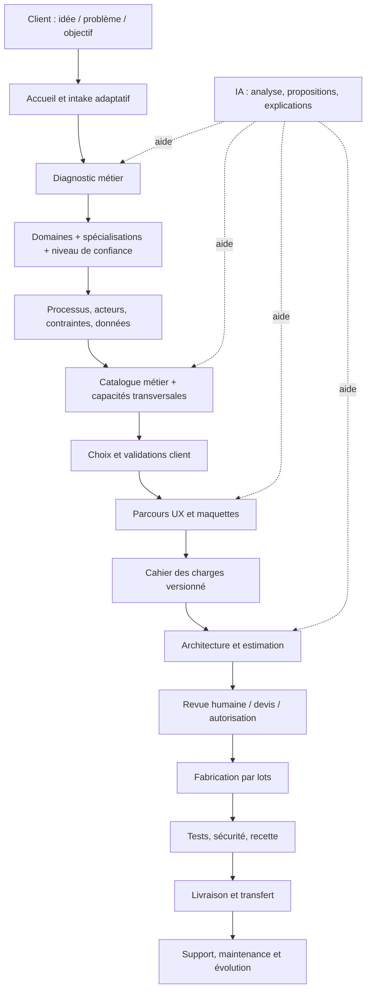

# 01 — Architecture fonctionnelle et technique cible

## 1. Vue d'ensemble

L'architecture doit séparer le parcours métier, le moteur de raisonnement, le catalogue de capacités, le studio de conception et l'exécution technique. Cette séparation évite qu'une simple modification d'un questionnaire métier casse la fabrication ou qu'une suggestion IA soit confondue avec une configuration active.

## 2. Couches logiques

### A. Expérience et canaux
- Application web responsive et installable en PWA.
- Parcours client, espace collaborateur et console administrateur clairement séparés.
- Interfaces adaptées aux rôles et aux appareils.
- Accessibilité, français simple et vocabulaire métier ; prévoir l'internationalisation ultérieure.

### B. Orchestration de projet
- Projet, organisation, demande, diagnostic, conversation, pièces jointes.
- État du cycle de vie et transitions autorisées.
- Tâches, validations, commentaires et notifications.
- Historique des décisions et versions de périmètre.

### C. Intelligence métier
- Registre de domaines, spécialisations, mots-clés, questions et options.
- Détection avec score et explication ; demande de confirmation si confiance faible ou domaines concurrents.
- Questionnaire adaptatif piloté par les inconnues importantes.
- Analyse des processus et des causes, pas seulement extraction de mots-clés.
- Recommandations accompagnées de raisons, hypothèses, risques et alternatives.

### D. Catalogue et composition
- Modules métier réutilisables.
- Capacités transversales : rôles, notifications, documents, paiements/facturation, tableaux de bord, audit, assistance, intégrations.
- Dépendances, incompatibilités, prérequis, niveaux de maturité et coût relatif.
- Sélection explicite, confirmation et version du périmètre.
- Composants spécifiques créés lorsque le catalogue ne répond pas au besoin.

### E. Studio de conception
- Cartes de parcours et rôles.
- Maquettes et prototypes adaptés au secteur.
- États vides, erreurs, validations, mobile et accessibilité.
- Comparaison de scénarios et annotations client.
- Toute maquette porte un statut « conceptuel », « validé » ou « à revoir ».

### F. Moteur de fabrication
- Génération du plan et du backlog à partir des spécifications confirmées.
- Bibliothèque de composants et modèles de projet.
- Génération de code assistée, avec revue et tests.
- Environnements isolés, branches, commits, previews et journal de fabrication.
- Aucun secret exposé dans le navigateur ; secrets gérés dans l'environnement serveur.

### G. Qualité et exploitation
- Tests unitaires, intégration, parcours, sécurité et acceptation.
- Observabilité, journaux, alertes, sauvegardes et restauration testée.
- Livraison avec documentation, accès, procédures et limites connues.
- Maintenance et évolutions selon contrat.

## 3. Objets métier à distinguer

| Objet | Rôle |
|---|---|
| Organization | Organisation cliente, établissements et paramètres |
| User / Membership | Personne et appartenance à une organisation |
| Project | Projet numérique demandé |
| Intake | Demande initiale et réponses |
| Diagnosis | Analyse, causes, objectifs, contraintes et confiance |
| DomainMatch | Domaines et spécialisations proposés |
| ProcessMap | Étapes métier, événements et exceptions |
| Option / Module | Capacité disponible dans le catalogue |
| ProjectScope | Options sélectionnées et confirmées, versionnées |
| Mockup / Prototype | Représentation de la solution |
| Specification | Exigences, règles, écrans, données, critères |
| Estimate / Quote | Estimation interne puis devis soumis à validation |
| BuildTask | Lot de fabrication et dépendances |
| TestRun | Cas, résultats, preuves et anomalies |
| Approval | Décision, auteur, date, objet et version |
| Delivery | Version remise, documentation et acceptation |
| ChangeRequest | Évolution hors périmètre initial |

## 4. Principes de données et d'architecture

- Chaque projet appartient à une organisation ; l'isolation entre clients est obligatoire.
- Les autorisations sont contrôlées côté serveur et au niveau des données.
- Les données sensibles sont séparées autant que possible des données opérationnelles ordinaires.
- Les changements de périmètre créent une nouvelle version ; ne pas écraser les validations antérieures.
- Les événements importants sont auditables : auteur, action, horodatage, objet et résultat.
- Les traitements asynchrones doivent être idempotents, rejouables et observables.
- Les intégrations sont encapsulées par adaptateurs ; leur disponibilité ne doit pas bloquer tout le projet.
- Les données de démonstration sont fictives et séparées des données réelles.

## 5. Architecture actuelle et cible

Le code actuel comprend notamment `domain-registry.ts`, `domain-options.ts`, le studio de maquette, les sélections de modules et la génération de plans. La cible documentée ici est plus large : workflow de validations, versionnement complet, catalogue avec dépendances, sécurité multi-organisation, pipeline de fabrication et exploitation. Ces éléments doivent être audités avant d'être déclarés implémentés.

## 6. Découpage recommandé des services internes

Commencer par un **monolithe modulaire** plutôt que des microservices prématurés. Séparer par modules de code et contrats stables : identity, organizations, projects, diagnosis, domains, catalog, scope, design, planning, factory, quality, delivery, billing, support. Extraire un service indépendant uniquement lorsqu'une contrainte mesurée de charge, sécurité, déploiement ou responsabilité le justifie.
