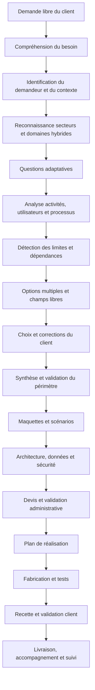

# 08 — Conception générale unifiée de MerKora GDJ

> Version 1.0 — 12 novembre 2026  
> Statut : **document directeur de conception — à valider avant réalisation des lots concernés**  
> Branche : `feature/merkora-factory-unified-runtime`

## Pourquoi ce document existe

Ce document rassemble en un seul parcours la conception universelle de MerKora GDJ. Il complète les 13 dossiers métiers et les documents d'architecture existants. Il décrit comment MerKora doit comprendre une demande, reconnaître plusieurs secteurs, analyser les limites, faire participer le client, concevoir une solution, organiser sa fabrication et vérifier le résultat.

Il ne prétend pas que chaque fonction décrite est déjà codée. Il sert de référence commune pour la conception, l'implémentation, les tests et les décisions futures. Aucun déploiement, achat, dépense, migration destructive ou changement de production n'est autorisé par ce document.

## 1. La vision : une fabrique universelle de solutions numériques

MerKora n'est pas une boutique de logiciels préfabriqués. C'est une plateforme qui transforme une situation réelle en solution numérique adaptée.

Le client n'a pas besoin de connaître les mots techniques. Il explique :
- son activité, son organisation ou son idée ;
- ce qui se passe aujourd'hui ;
- le problème et ses causes possibles ;
- les personnes concernées ;
- ce qu'il veut améliorer ou obtenir ;
- ses contraintes et ses priorités.

MerKora analyse, pose les questions utiles, présente des possibilités, montre les limites et construit progressivement une proposition. Le client reste décisionnaire : il peut cocher plusieurs options, en retirer, les corriger, ajouter des besoins libres et confirmer le périmètre.

**Principe directeur : comprendre avant de proposer, expliquer avant de faire choisir, confirmer avant de fabriquer.**

## 2. Les domaines : 13 dossiers métiers existants et une taxonomie cible de 20 familles

Les 13 dossiers métiers existants constituent le socle documentaire déjà organisé dans le dépôt. La vision cible prévoit une taxonomie extensible de 20 grands domaines et un référentiel pouvant atteindre environ 500 secteurs, métiers, sous-métiers et activités.

Il faut distinguer :
- les **13 dossiers métiers documentés aujourd'hui**, détaillés dans le répertoire `domaines/` ;
- les **20 familles de classification proposées**, qui constituent une évolution cible ;
- les **quelque 500 secteurs visés**, qui restent à constituer, vérifier, enrichir et versionner progressivement.

Les 20 familles proposées :

1. Santé, médecine, pharmacie et bien-être.
2. Sport, fitness, loisirs sportifs et compétitions.
3. Agriculture, élevage, pêche et environnement.
4. Commerce, distribution, vente et e-commerce.
5. Finance, comptabilité, assurance et gestion patrimoniale.
6. Entrepreneuriat, direction et gestion des organisations.
7. Immobilier, architecture, urbanisme, BTP et maintenance des bâtiments.
8. Éducation, formation, recherche et orientation.
9. Transport, mobilité, logistique et automobile.
10. Restauration, alimentation, hôtellerie et hébergement.
11. Événementiel, culture, tourisme et voyages.
12. Ressources humaines, recrutement et organisation du travail.
13. Artisanat, fabrication, industrie et métiers techniques.
14. Services aux personnes, services à domicile et assistance.
15. Administration, collectivités, services publics et citoyenneté.
16. Droit, conformité, médiation et services juridiques.
17. Numérique, informatique, télécommunications et médias digitaux.
18. Énergie, eau, assainissement et services essentiels.
19. Sécurité, prévention, sûreté et gestion des risques.
20. Famille, vie personnelle, associations, solidarité et communauté.

Cette taxonomie doit être revue pour éviter les doublons et les frontières artificielles. Une activité peut être liée à plusieurs familles. Les identifiants historiques des 13 domaines ne doivent pas être supprimés ou renommés sans migration contrôlée et compatibilité.

### Référentiel de secteurs

Chaque entrée devra contenir un identifiant stable, un nom, une description, des synonymes, des exemples d'activités, ses domaines liés, des processus fréquents, des profils utilisateurs, des capacités possibles, des questions de diagnostic, des risques et une version. Les entrées seront ajoutées par lots validés, plutôt que générées en masse sans contrôle de qualité.

## 3. Reconnaissance intelligente : classer le projet, pas seulement la profession

MerKora doit comprendre le besoin réel et non déduire les fonctions à partir du seul métier du demandeur.

La classification comporte quatre niveaux :

- **Domaine principal** : celui qui porte l'objectif principal de la solution.
- **Domaines secondaires** : autres domaines dont les processus sont réellement concernés.
- **Secteurs et spécialisations** : métier ou type d'activité précis.
- **Capacités transversales** : fonctions réutilisables entre métiers, comme présence, gestion des rôles, finances, communication, documents, rappels, paiements, rapports ou audit.

Un projet peut être hybride. Exemple : une médecin veut suivre les présences du personnel de son cabinet, gérer les rendez-vous et les demandes des patients, suivre les finances du cabinet et organiser séparément le budget de sa famille. La solution doit comprendre santé, RH, finance et usage familial, sans fusionner les espaces ni les données.

### États de classification

- **Claire** : le but, les activités et les utilisateurs sont suffisamment compris.
- **Hybride** : plusieurs domaines sont effectivement impliqués.
- **Incertaine** : une information manque ; MerKora pose une question ciblée.
- **À confirmer** : l'analyse est compréhensible, mais le client n'a pas encore validé la classification.

La classification conserve les éléments détectés, les raisons, les niveaux de confiance, les corrections du client et la version confirmée. Un score de confiance IA n'est jamais une preuve ni un consentement.

## 4. Le parcours de conception complet du client

Le parcours doit être conversationnel et adaptatif. Il ne doit pas afficher d'un coup un formulaire interminable. MerKora pose une question utile à la fois, ou un petit groupe de questions réellement liées, en réutilisant les réponses déjà données.

### 4.1 Accueil et expression libre

Le client peut décrire son projet avec ses propres mots, joindre des exemples si l'interface le permet, et expliquer ce qui le dérange. MerKora reformule ce qu'il a compris et laisse le client corriger.

Questions possibles :
- Que faites-vous ou que voulez-vous créer ?
- Qu'est-ce qui ne fonctionne pas aujourd'hui ?
- Pourquoi cela pose-t-il problème ?
- Qui est concerné ?
- Quel résultat voudriez-vous obtenir ?

### 4.2 Identification du contexte

Identifier le type de demandeur et la structure concernée : particulier, indépendant, entreprise, association, établissement, collectivité, famille, communauté ou autre. Demander uniquement les renseignements utiles au projet. Ne pas collecter des informations personnelles inutiles.

### 4.3 Reconnaissance des domaines et secteurs

Présenter la classification proposée avec une explication simple. Le client peut :
- cocher plusieurs domaines ou secteurs ;
- définir celui qui est prioritaire ;
- décocher une proposition non pertinente ;
- ajouter un secteur absent du catalogue ;
- décrire librement une activité particulière ;
- demander à MerKora de réexaminer son classement.

### 4.4 Analyse des activités et processus

Pour chaque activité retenue, comprendre les opérations réelles : déclencheur, étapes, acteurs, données saisies, décisions, validations, exceptions, documents, destinataires et résultat attendu.

### 4.5 Identification des utilisateurs et rôles

Identifier toutes les catégories d'utilisateurs :
- propriétaire, client principal ou administrateur ;
- direction et responsables ;
- employés, agents, intervenants ou prestataires ;
- clients finaux, patients, élèves, membres, fournisseurs ou partenaires ;
- visiteurs et utilisateurs publics ;
- support ou administrateurs techniques, selon le besoin.

Pour chaque profil, préciser ce qu'il doit faire, voir, créer, modifier, approuver, exporter ou supprimer. MerKora propose une matrice de rôles et permissions, mais le responsable habilité la confirme. Le principe du moindre privilège s'applique.

### 4.6 Identification, connexion et appareils

Le diagnostic explore les méthodes adaptées : compte individuel, e-mail, téléphone, mot de passe, code, authentification renforcée, badge, QR code ou appareil spécialisé. Il demande quels appareils sont disponibles : téléphone, ordinateur, tablette, terminal partagé ou matériel métier.

Il vérifie aussi :
- qualité et disponibilité de la connexion ;
- besoin de fonctionnement hors ligne ;
- utilisation sur plusieurs sites ;
- partage éventuel des appareils ;
- récupération de compte et assistance.

La biométrie n'est jamais activée par défaut. Elle nécessite une justification, une analyse des risques, des garanties adaptées et une validation distincte.

### 4.7 Contacts, communication et relation avec les clients finaux

MerKora demande comment les clients, patients, membres ou partenaires doivent contacter l'organisation :
- formulaire public ou demande de rendez-vous ;
- espace client authentifié ;
- messagerie intégrée ;
- téléphone, e-mail ou WhatsApp si les intégrations et consentements le permettent ;
- demandes adressées à un service ou à une personne responsable.

Préciser qui reçoit chaque demande, qui répond, les délais attendus, les informations visibles et les règles de confidentialité. Aucune coordonnée privée ne devient publique automatiquement.

### 4.8 Notifications et rappels

Identifier les événements à signaler, les destinataires, les canaux, les délais et la priorité : rendez-vous, absence, retard, paiement, demande reçue, stock bas, document manquant, validation en attente, incident ou rapport prêt.

Séparer alertes opérationnelles, rappels configurables et communications promotionnelles. Définir préférences, consentements nécessaires, fréquence, historique et traitement des échecs.

### 4.9 Données, documents et finances

Selon le besoin, examiner :
- dossiers et fiches métier ;
- documents, justificatifs, contrats et pièces jointes ;
- recettes, dépenses, budgets, paiements et factures ;
- stocks, commandes et fournisseurs ;
- rapports journaliers, hebdomadaires et mensuels ;
- tableaux de bord, exports et historique.

Ne pas supposer qu'un métier a besoin de toutes ces fonctions. Un professionnel de santé n'a pas automatiquement besoin d'un dossier médical numérique ; un commerçant n'a pas automatiquement besoin d'une comptabilité complète.

### 4.10 Intégrations et automatisations

Identifier les outils déjà utilisés et ce que le client souhaite connecter : messagerie, calendrier, paiement, stockage, comptabilité, matériel, API ou autres services. Pour chaque intégration, afficher les prérequis, la disponibilité, les limites, les coûts éventuels, les données échangées et une solution alternative.

Aucun service externe ne doit être présenté comme connecté ou gratuit tant que cela n'a pas été vérifié.

### 4.11 Contraintes, priorités et validation

Demander les contraintes qui changent la solution : budget, calendrier, langues, accessibilité, niveau numérique, matériel, hébergement, maintenance, confidentialité, réglementation et évolutivité.

Classer les besoins : indispensable, important, facultatif, souhaité plus tard. Le client examine la synthèse et confirme le périmètre avant la maquette détaillée et le devis.

## 5. Le système des limites, propositions et cases à cocher

C'est une fonction centrale de la conception MerKora.

L'IA ne doit pas seulement proposer des modules. Elle doit comparer le besoin exprimé avec les informations disponibles, identifier les zones non couvertes, les risques, les dépendances et les décisions manquantes.

Chaque limite devient une fiche :

1. **Ce que MerKora a détecté** : fait manquant, risque, contradiction, dépendance ou limite fonctionnelle.
2. **Pourquoi cela compte** : conséquence concrète si rien n'est prévu.
3. **Ce qui peut être ajouté** : options pertinentes, présentées en langage simple.
4. **Choix du client** : cases à cocher multiples, lorsque cela a du sens.
5. **Précision libre** : petit champ pour expliquer, corriger ou ajouter un besoin.
6. **Décision** : retenu, refusé, à confirmer, reporté ou non applicable.
7. **Conséquence** : mise à jour du périmètre, des rôles, du coût estimatif, du plan ou des risques.

### Exemple de fiche de limite

**Limite détectée :** le système enregistre les présences, mais aucune règle de correction ou de validation n'est définie.

**Pourquoi c'est important :** une heure erronée ou une absence contestée pourrait être modifiée sans contrôle.

**Quelles options souhaitez-vous ?**
- [ ] L'employé peut demander une correction avec justification.
- [ ] Le responsable de service valide les corrections.
- [ ] La direction valide les exceptions.
- [ ] Chaque modification conserve un historique.
- [ ] Une notification informe le responsable.
- [ ] Autre : champ libre « Décrivez votre règle ».

La liste n'est pas exclusive. Le client peut sélectionner plusieurs réponses, aucune, ou proposer sa propre règle. MerKora doit expliquer les dépendances et poser une question si un choix est ambigu.

### Règle de non-sélection automatique

Une option recommandée n'est pas considérée comme choisie. Les cases ne doivent pas être cochées silencieusement. Les options indispensables au fonctionnement doivent être signalées comme dépendances et expliquées. Si une option est refusée, MerKora doit montrer les conséquences possibles et proposer une alternative.

## 6. Architecture fonctionnelle cible

Le parcours complet s'organise ainsi :

Les composants doivent rester séparés : intake, classification, catalogue de secteurs, moteur de questions, analyse des écarts, sélection client, gestion du périmètre, studio de maquette, génération de plan, fabrication, tests et livraison.

## 7. Données de conception à conserver

Le modèle de données doit garder distincts les faits fournis, les propositions de l'IA, les choix du client et les validations.

Entités conceptuelles :
- `ProjectIntake` : demande initiale, contexte et objectifs.
- `ProjectClassification` : domaine principal, domaines secondaires, secteurs, spécialisations, justification, confiance et confirmation.
- `SectorCatalogEntry` : secteur versionné, synonymes, processus et domaines liés.
- `ActivityContext` : activités, sites, opérations et relations.
- `StakeholderProfile` : utilisateurs, parties prenantes et responsabilités.
- `RoleProposal` : rôle, permissions proposées, justification et validation.
- `QuestionnaireItem` et `QuestionnaireResponse` : questions, réponses, auteur et date.
- `GapFinding` : limite, preuve, conséquence, priorité et statut.
- `OptionProposal` : option, origine, domaine, dépendances et explication.
- `ClientSelection` : choix, refus, texte libre, auteur et confirmation.
- `CommunicationPreference` : canaux, destinataires et préférences.
- `NotificationRule` : événement, destinataire, canal, fréquence et priorité.
- `IntegrationRequirement` : service ou appareil, prérequis, disponibilité et coût à confirmer.
- `ScopeDecision` : inclus, exclu, reporté ou à confirmer, avec historique.

Ces noms sont conceptuels et doivent être adaptés aux conventions et schémas existants après audit. Aucune table existante ne doit être supprimée ou réinitialisée pour adopter ce modèle.

## 8. Comment les réponses pilotent la solution

Les informations confirmées doivent être réutilisées sans perte par tous les modules suivants :

| Élément de conception | Ce qu'il doit alimenter |
|---|---|
| Domaines et secteurs | Questionnaire, catalogue métier et règles adaptées |
| Activités et processus | Parcours utilisateurs et fonctions nécessaires |
| Profils et rôles | Espaces, permissions et validations |
| Contacts et communication | Portails, formulaires, messagerie et routage |
| Notifications | Événements, destinataires et canaux |
| Connexion et appareils | Choix techniques et scénarios d'utilisation |
| Limites et options choisies | Périmètre, maquettes et critères d'acceptation |
| Données et documents | Modèle de données, sécurité et conservation |
| Intégrations | Architecture, dépendances, coûts et tests |
| Contraintes et priorités | Devis, lots, calendrier et arbitrages |

La même source de vérité doit alimenter le studio de maquette, le générateur de plan, le moteur de fabrication, les tests et l'espace administrateur.

## 9. Maquettes et validation visuelle

MerKora transforme les choix en maquettes compréhensibles :
- écrans par profil et par rôle ;
- navigation et parcours ;
- exemples de formulaires et tableaux de bord ;
- états normaux, erreurs, alertes et validations ;
- versions mobile et ordinateur lorsque nécessaires ;
- aperçu des bénéfices et limites.

Chaque écran doit correspondre à un besoin ou à une option retenue. Les éléments non retenus peuvent être montrés comme suggestions, mais doivent être clairement distingués des fonctions incluses. Le client peut annoter, demander une modification et confirmer une version.

## 10. De la conception à la fabrication

Après confirmation du périmètre :

1. Transformer les besoins en exigences vérifiables.
2. Définir les rôles, permissions et scénarios d'accès.
3. Concevoir l'architecture et le modèle de données.
4. Identifier les intégrations et leurs prérequis.
5. Découper la réalisation en lots et tâches.
6. Estimer la complexité, le temps et les ressources.
7. Faire réviser le devis par l'administration MerKora avant présentation au client.
8. Développer et tester chaque lot.
9. Faire une recette avec le client.
10. Corriger les anomalies, documenter et préparer la livraison.
11. Déployer uniquement après autorisations et validations distinctes.

Le moteur de fabrication doit recevoir un dossier de conception confirmé, et non interpréter seul une conversation brute comme une commande de développement.

## 11. Espaces et responsabilités

### Espace client
- Décrire et corriger le besoin.
- Voir la classification et les raisons.
- Cocher plusieurs options et ajouter des précisions.
- Répondre aux questions et examiner les limites.
- Valider le périmètre et les maquettes.
- Suivre les étapes, demandes de validation et livraisons.
- Gérer ses préférences de contact et de notification.

### Espace administrateur MerKora
- Examiner les demandes et classifications incertaines.
- Corriger les référentiels avec contrôle de version.
- Examiner les limites, risques et options proposées.
- Valider les devis et arbitrages.
- Attribuer les responsables de conception, développement et contrôle.
- Suivre tâches, anomalies, livraisons, paiements et support.
- Auditer les actions et validations.

### Espaces métier du produit final
Selon le projet, les utilisateurs finaux disposent de leurs propres espaces et droits. Il n'existe pas un modèle unique de rôles applicable à tous les métiers : la matrice est produite à partir du diagnostic, puis validée.

## 12. Sécurité, confidentialité et précautions

- Collecter uniquement les données nécessaires.
- Séparer les espaces personnels, professionnels et les organisations lorsque requis.
- Appliquer le moindre privilège et réviser les permissions.
- Protéger les données sensibles, les pièces jointes, les exports et les sauvegardes.
- Tracer les opérations sensibles et les changements de droits.
- Ne pas rendre les coordonnées personnelles publiques par défaut.
- Ne pas activer la biométrie ou une intégration sensible sans justification et validation.
- Prévoir conservation, rectification, export et suppression selon les obligations applicables.
- Adapter les précautions aux secteurs : santé, finance, droit, éducation, services publics, etc.
- Ne pas prétendre qu'une solution est conforme à une réglementation sans analyse et vérification adaptées.

## 13. Modèle commercial et contrôle des engagements

La conception doit fournir les informations nécessaires à l'estimation, sans engager automatiquement le client :
- conception et réalisation sur devis ;
- abonnement d'utilisation MerKora selon l'offre retenue ;
- hébergement, maintenance et développements spécifiques selon le projet ;
- limites, dépendances et coûts de services tiers clairement signalés.

L'administration vérifie le devis avant sa présentation. Aucun achat, abonnement externe, paiement, publication ou engagement financier ne découle d'une simple recommandation IA.

## 14. Exemple hybride détaillé : cabinet médical et budget familial

Une médecin dirige un cabinet et souhaite un système de présence, de rendez-vous, de suivi financier et de budget familial.

MerKora détecte :
- domaine principal : santé et gestion du cabinet ;
- domaine secondaire : ressources humaines ;
- domaine secondaire : finance et gestion ;
- usage personnel séparé : budget familial ;
- capacités transversales : identité, rôles, présence, agenda, communication, notifications, rapports et historique.

Questions adaptatives :
- Qui travaille dans le cabinet et qui valide les présences ?
- Les employés peuvent-ils demander une correction ?
- Les patients peuvent-ils prendre rendez-vous en ligne ?
- Qui reçoit et traite les demandes des patients ?
- Quelles notifications doivent être envoyées, à qui et par quel canal ?
- Quelles données médicales sont strictement nécessaires ?
- Qui saisit les recettes et dépenses du cabinet ?
- Le budget familial doit-il être accessible uniquement à la médecin ?
- Quels appareils et quelles connexions sont disponibles ?

Options à cocher : validation des présences, rappels de rendez-vous, formulaire patient, rapports de caisse, dépenses, exports, authentification renforcée, espace familial privé, etc. La médecin peut ajouter des règles libres. Les données du budget familial restent invisibles au personnel du cabinet. Les données de santé ne sont collectées que si le périmètre le justifie.

## 15. Critères d'acceptation globaux

1. Un projet peut combiner plusieurs domaines, secteurs et capacités transversales.
2. La profession du demandeur n'impose pas la classification.
3. L'incertitude est explicitée et conduit à une question ciblée.
4. Le client peut cocher plusieurs propositions, les refuser, les modifier et ajouter du texte libre.
5. Chaque limite affiche sa raison, sa conséquence et des options pertinentes.
6. Les questions couvrent selon le contexte identification, utilisateurs, rôles, accès, contacts, notifications, connexion, appareils, données, documents, finances, intégrations et contraintes.
7. Les réponses confirmées alimentent les maquettes, plans, architecture et tests.
8. Les propositions non confirmées ne deviennent pas automatiquement des fonctions commandées.
9. Les espaces et données sensibles sont séparés selon les rôles et finalités.
10. Les 13 domaines historiques restent compatibles pendant l'évolution de la taxonomie.
11. Le catalogue de secteurs peut croître progressivement vers environ 500 entrées, avec validation et versionnage.
12. Aucun déploiement, dépense ou changement de production n'est déclenché par le seul diagnostic.

## 16. Documents complémentaires à lire

- [00 — Vision, principes et périmètre](./00-vision-principes-et-perimetre.md)
- [01 — Architecture fonctionnelle et technique cible](./01-architecture-fonctionnelle-et-technique.md)
- [02 — Méthode de travail et cycle de fabrication](./02-methode-de-travail-et-cycle-de-fabrication.md)
- [03 — Organisation, gouvernance et contrôles](./03-organisation-gouvernance-et-controles.md)
- [04 — Socle transversal et règles communes](./04-socle-transversal-et-regles-communes.md)
- [05 — Plan de mise en œuvre et critères de réussite](./05-plan-de-mise-en-oeuvre-et-criteres-de-reussite.md)
- [06 — Glossaire et décisions ouvertes](./06-glossaire-et-decisions-ouvertes.md)
- [07 — Conception hybride et parcours client adaptatif](./07-conception-hybride-et-parcours-client.md)
- [Les 13 dossiers métiers](./domaines/README.md)

## 17. Règle finale

MerKora doit comprendre le besoin avant de choisir une catégorie, reconnaître les projets hybrides, expliquer ses recommandations, montrer les limites, donner au client la possibilité de cocher plusieurs choix et d'ajouter ses propres besoins, puis transformer uniquement les décisions confirmées en solution à concevoir et à fabriquer.

**Le client décrit et décide. MerKora analyse, explique, propose, organise et fabrique sous contrôle.**
